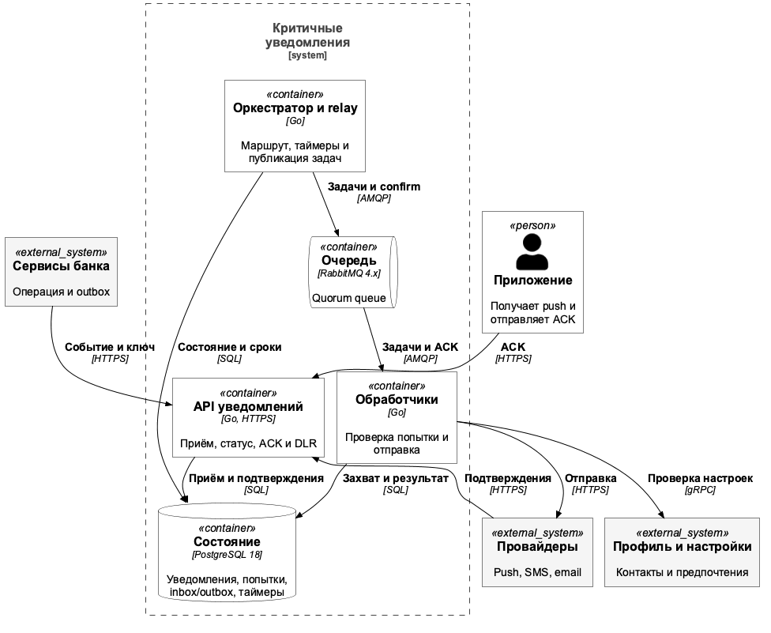
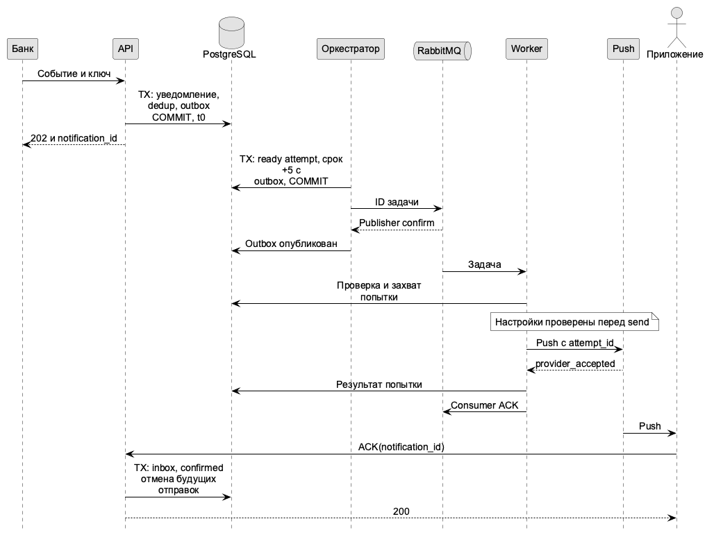
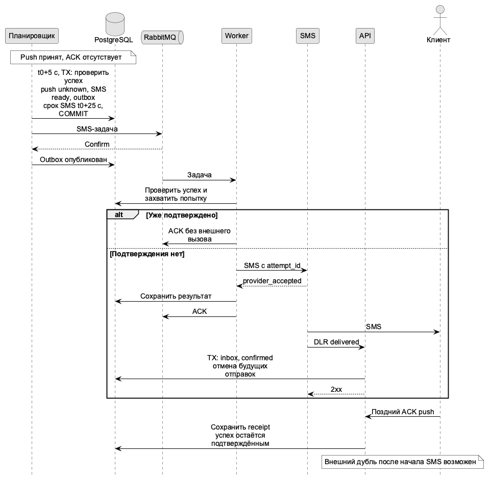
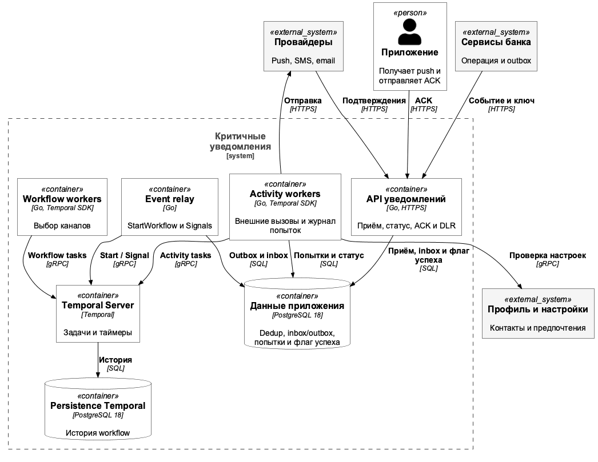
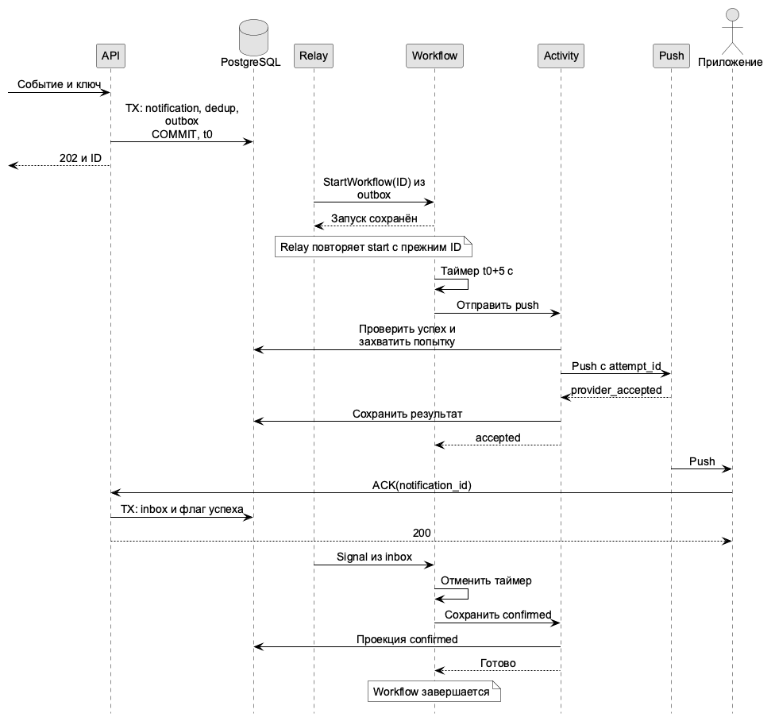
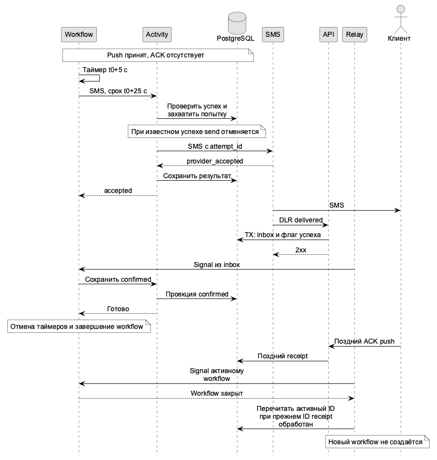

# Домашнее задание №4

Требования и архитектура платформы уведомлений онлайн-банка

## 1. Функциональные требования

Платформа принимает транзакционные, сервисные и маркетинговые уведомления и отправляет их через push, SMS и email. К критичным относятся сообщения о движении денег и безопасности счёта.

Бизнес-цели: Б1 - рост retention на 15%, Б2 - снижение жалоб на 30%, Б3 - надёжная доставка критичных сообщений.

| ID | Требование | Цели |
|---|---|---|
| FR1 | После списания или перевода пользователь получает уведомление об операции. | Б1, Б3 |
| FR2 | Если основной канал не подтвердил доставку вовремя, платформа использует доступный резервный канал. | Б2, Б3 |
| FR3 | Пользователь выбирает предпочтительный канал, отключает маркетинг и отдельные сервисные категории. Критичные уведомления нельзя отключить полностью. Изменения применяются к ещё не начатым отправкам. | Б1, Б2, Б3 |
| FR4 | Повтор одного события не создаёт новое логическое уведомление. В истории приложения событие отображается одной записью. | Б2 |
| FR5 | Маркетолог запускает и останавливает кампанию до 1 млн получателей. Отправка учитывает согласия, категории, тихие часы и лимиты пользователя. | Б1, Б2 |
| FR6 | Поддержка и команда-отправитель видят разрешённые им сведения о состоянии, попытках доставки и причинах отказа. | Б2, Б3 |
| FR7 | При недоставке платформа создаёт задачу разбора. После исправления контакта или сбоя оператор может возобновить доставку того же уведомления. | Б2, Б3 |
| FR8 | При стандартных настройках платформа сначала использует push и ограничивает платные повторы. Выбранный пользователем первый канал имеет приоритет. | Б1, Б3 |

Для маркетинга принимаю тихие часы с 21:00 до 09:00 по времени пользователя и лимит до пяти сообщений в день. Критичные сообщения отправляются круглосуточно. Пользователь может исключать резервные каналы, пока остаётся хотя бы один подтверждённый контакт. Запрет push в ОС учитывается как недоступность канала.

## 2. Нефункциональные требования

`t0` обозначает момент надёжного сохранения уведомления платформой. SLO задаёт целевой уровень качества. Числа ниже выбраны для проекта и требуют проверки на стенде.

| ID | Требование и способ проверки |
|---|---|
| NFR1 | Доступность приёма критичных уведомлений и проверки статуса не ниже 99,95% за месяц для корректных запросов в согласованной квоте. p99 ответа приёма не больше 200 мс при нагрузке NFR3. Внутренние ошибки и нехватка мощности учитываются как недоступность. |
| NFR2 | p99 времени от `t0` до первого внешнего вызова не больше 1 с. Не менее 99,9% принятых критичных уведомлений подтверждены каналом за 60 с за месяц. Для устройств онлайн на `t0` p95 ACK приложения не больше 3 с. Отказы провайдеров и непригодные контакты остаются в статистике. |
| NFR3 | Приём 8 000 уведомлений/с в течение 30 минут, включая 1 200 критичных/с. Кампания на 1 млн разрешённых адресатов передаётся провайдерам за 10 минут с сохранением задержки критичного потока из NFR2. |
| NFR4 | RPO=0 для принятых критичных уведомлений при потере одного узла или одной из трёх зон. RTO не больше 60 с. Проверка отключением узла и зоны на стенде. Отказ региона рассматривается отдельно. |
| NFR5 | Бизнес-ключ защищён от повторов 90 суток. В тесте со 100 тыс. повторных и конкурентных запросов создаётся один логический ID на ключ. |
| NFR6 | Настройки применяются к ещё не начатым отправкам не позже 60 с после изменения. Маркетинг при неизвестном согласии не отправляется. Проверка сменой настроек при накопленной очереди. |
| NFR7 | Все обращения аутентифицированы, доступ ограничен ролями. Контакты зашифрованы при передаче и хранении. В обычных логах отсутствуют полные контакты, номера карт и тексты операций. Проверка прав и логов перед релизом. |
| NFR8 | Каждая попытка имеет ID и сохранённый исход. История доступна 90 суток, из них 30 в оперативном хранилище. Массовый сбой обнаруживается за 60 с, задача единичной недоставки создаётся не позже `t0+65 с`. |
| NFR9 | При исправных каналах доля уведомлений с SMS не больше 15% за сутки среди пользователей с пригодным push и настройкой «push первым» на `t0`. Расходы считаются по фактическим попыткам. |

Разрешённый адресат кампании имеет согласие, доступный канал и свободную квоту в выбранном десятиминутном окне. Остальные отправки переносятся. Устройство считается онлайн при активной сессии и heartbeat не старше 30 с. Отсутствующий ACK считается неуспехом и входит в расчёт p95. Задержка между банковской операцией и `t0` измеряется отдельно.

## 3. Архитектурно значимые требования

| ASR | Приоритет | Связанные требования | Влияние на архитектуру |
|---|---|---|---|
| ASR1. Сохранность доставки | Обязательно | FR1, FR6, FR7, NFR1, NFR4, NFR8 | Состояние и обязательство обработки должны переживать перезапуск. Нужны репликация, атомарная запись и восстановление зависших задач. |
| ASR2. Задержка под нагрузкой | Обязательно | FR1, FR5, NFR2, NFR3 | Массовая кампания требует изоляции ресурсов критичного потока и ограничения скорости отправки. |
| ASR3. Failover и дубли | Обязательно | FR2, FR4, FR7, NFR2, NFR5 | Таймеры и поздние подтверждения требуют одного владельца маршрута, общего ID и согласованных переходов состояния. |
| ASR4. Настройки и данные | Обязательно | FR3, FR5, FR6, NFR6, NFR7 | Перед отправкой нужна проверка актуальной политики. Доступ к контактам и истории ограничивается. |
| ASR5. Стоимость | Желательно | FR3, FR8, NFR9 | Порядок каналов и число платных повторов должны управляться общей политикой доставки. |

## 4. Ключевые архитектурные вопросы

| Вопрос | Источник | Почему важен |
|---|---|---|
| Когда событие считается принятым и кто отвечает за него до этого момента? | FR1, FR7, ASR1 | Ранний ответ об успехе создаёт окно потери сообщения. Нужна граница ответственности источника и платформы. |
| Какой ответ подтверждает доставку и что делать при позднем ACK? | FR2, FR4, ASR3 | От этого зависят запуск резерва, расчёт SLO и риск дубля. |
| Где хранить маршрут и таймеры: в своём сервисе или Temporal? | ASR1, ASR3 | Выбор определяет сложность восстановления и состав инфраструктуры. |
| Как защитить критичный поток от кампании на миллион получателей? | FR5, ASR2 | Разделение должно охватывать БД, обработчики и квоты внешних провайдеров. |

## 5. Архитектурные последствия ASR

| ASR | Последствия |
|---|---|
| ASR1 | Асинхронная доставка, надёжное хранилище состояния, outbox/inbox, репликация и поиск зависших задач. |
| ASR2 | Отдельные ресурсы критичного потока, горизонтальное масштабирование обработчиков и ограничение скорости кампаний. |
| ASR3 | Автомат состояний, бизнес-ключ, ID попытки, сохранённые дедлайны и идемпотентная обработка подтверждений. |
| ASR4 | Проверка настроек и контактов перед отправкой, ролевая модель доступа, шифрование и маскирование логов. |
| ASR5 | Последовательная отправка, push по умолчанию, ограничение повторов SMS и учёт стоимости по каналам. |

## 6. Решения, которые не подходят

| Решение | Нарушаемые ASR | Причина |
|---|---|---|
| Синхронно вызывать провайдеров из сервиса переводов | ASR1, ASR2 | Задержка провайдера увеличивает время перевода. Падение после банковской операции может потерять уведомление. |
| Одна FIFO-очередь и общий пул для всех типов | ASR2 | Миллион маркетинговых сообщений занимает обработчики и задерживает критичные. Общие квоты провайдера сохраняют проблему даже при разных очередях. |

## 7. Неопределённости и риски

| Что неизвестно | Риск | Как проверить |
|---|---|---|
| Частоты относятся к DAU или MAU, каковы реальные пики | Недостаточная мощность приёма и БД | Снять статистику за 2-4 недели. Испытать полный процесс с callbacks, таймерами и отказом узла. В RFC рассчитаны обе трактовки. |
| Как быстро приложение подтверждает push в фоне | Лишние SMS и нарушение задержки | Проверить iOS/Android в фоне, при энергосбережении и плохой сети. Измерить долю ACK за 5 с. |
| Какие статусы, квоты и идемпотентность дают провайдеры | Дубли после таймаутов и перегрузка SMS при отказе push | Проверить договоры, sandbox и пилот. Подтвердить резерв на 1 200 первых SMS/с у одного доступного провайдера. |
| Сколько уведомлений нельзя подтвердить из-за контактов | Недостижимость SLO 99,9% | Измерить покрытие и провести пилот. Если доля таких сообщений выше 0,1%, SLO недостижим даже при исправной платформе. |

## 8. RFC. Гарантированная доставка критичных уведомлений с кросс-канальным failover

| Метаданные | Значение |
|---|---|
| Статус | DRAFT |
| Автор | Павел Ефимов |
| Ответственный | Автор проекта |
| Бизнес-заказчик | Владелец клиентских коммуникаций банка |
| Ревьюеры | Не назначены |
| Дата создания | 2026-11-16 |
| Дата обновления | 2026-11-17 |

#### Оглавление

8.1. Контекст. 8.2. Продуктовый анализ. 8.3. Пользовательские сценарии. 8.4. Статистика. 8.5. Требования. 8.6. Варианты решения. 8.7. Сравнительный анализ. 8.8. Выводы. 8.9. Связанные задачи. 8.10. Приложения.

### 8.1. Контекст

Команды банка отправляют уведомления самостоятельно. Общего состояния доставки нет, поэтому повторы и сбои трудно расследовать. Предлагается общий механизм доставки критичных сообщений после завершения банковской операции. Кампании и сервисные уведомления используют отдельные ресурсы платформы.

Под гарантией в этом RFC понимаю сохранность принятого задания в модели NFR4, автоматические попытки по согласованной политике и явный учёт недоставки. Цель подтверждения задана в NFR2. Получение человеком при выключенном телефоне, непригодных контактах или отказе всех каналов обеспечить невозможно. Такие случаи нарушают SLO и остаются в разборе.

### 8.2. Продуктовый анализ

Результат оценивается по трём показателям:

- D30 retention. Целевой рост 15% относительно исходного уровня, например с 40% до 46%. Измерение по сопоставимым когортам после полного D30-окна.
- Жалобы на дубли, задержки и нежелательные сообщения. Цель снижения 30% на 1 млн уведомлений относительно четырёх недель до внедрения. Дополнительно проверяется число жалоб на активного пользователя.
- Доля критичных уведомлений, подтверждённых за 60 с, с разбивкой по каналам и причинам недоставки.

Вклад уведомлений в retention проверяется отдельно от технического SLO. Для необязательных коммуникаций подходит A/B-тест. Критичные сообщения получают все пользователи.

### 8.3. Пользовательские сценарии

| Приоритет | Тип | Участник | Сценарий |
|---|---|---|---|
| Обязательно | Основной | Клиент | После перевода приложение подтверждает push. Резерв не используется. |
| Обязательно | Failover | Клиент | ACK нет за 5 с. Платформа отправляет SMS и учитывает DLR. |
| Обязательно | Недоставка | Поддержка | Видит причину и историю. После исправления контакта возобновляет уведомление. |

### 8.4. Статистика и расчёт нагрузки

В задании указаны MAU 10 млн, DAU 3 млн и до 300 тыс. одновременных пользователей. Частоты составляют 2 транзакционных, 3 сервисных и 5 маркетинговых уведомлений на пользователя в день.

Для базового расчёта беру DAU. Коэффициент пика принимаю равным 10. Маркетинговые частоты считаю до применения согласий и лимитов. Кампания добавляется сверх обычного потока.

| Тип | В сутки | Среднее, уведомлений/с | Пик ×10, уведомлений/с |
|---|---:|---:|---:|
| Транзакционные | 6 000 000 | 69,44 | 694,44 |
| Сервисные | 9 000 000 | 104,17 | 1 041,67 |
| Маркетинговые | 15 000 000 | 173,61 | 1 736,11 |
| Всего | 30 000 000 | 347,22 | 3 472,22 |

Средний поток: `30 000 000 / 86 400 = 347,22/с`.

Кампания: `1 000 000 / 600 = 1 666,67/с`. Совмещённый пик: `3 472,22 + 1 666,67 = 5 138,89/с`. Цель 8 000/с даёт около 56% запаса. Резерв критичного потока 1 200/с примерно на 73% выше его расчётного пика.

Если частоты относятся к MAU, получится 100 млн уведомлений в сутки и пик с кампанией `100 000 000 / 86 400 × 10 + 1 666,67 = 13 240,74/с`. Тогда требуется пересмотр мощности и испытание минимум на 15 000/с. Одновременные пользователи сами по себе не задают частоту событий. Постоянные соединения с устройствами обслуживают push-провайдеры.

Для оценки попыток принимаю 10% переходов в SMS и 1% в email. Получается `6 млн × (1 + 0,10 + 0,01) = 6,66 млн` попыток в день до транспортных повторов. При полном отказе push резерв SMS должен принять 1 200 первых отправок/с. Для одного повтора с тем же ключом нужен запас до 2 400 API-вызовов/с. Первые отправки имеют приоритет перед повторами. Квоты кампаний выделяются отдельно.

При трёх каналах верхняя граница первых отправок составляет 3 600/с, с одним транспортным повтором на канал до 7 200/с. ACK, callbacks и запросы статуса проверяются отдельной нагрузкой.

Для критичных уведомлений при условных 2 KiB метаданных и истории на событие объём равен `6 млн × 2 048 = 12,29 GB/сутки`, около 369 GB за 30 дней. Индексы с коэффициентом 2 и три копии увеличивают оценку до 2,2 TB без WAL и резервных копий. Ключи дедупликации за 90 дней и служебная история Temporal требуют дополнительного места.

### 8.5. Требования к механизму доставки

#### Функциональные требования

Обязательны FR1-FR7 из раздела 1. FR8 имеет желательный приоритет. Для подсистемы уточняются подтверждения, резервирование и повторы.

#### Нефункциональные требования

Обязательны NFR1-NFR8 из раздела 2. NFR9 имеет желательный приоритет. Расчёт нагрузки приведён в разделе 8.4. Приоритеты ASR заданы в разделе 3.

#### Подтверждение доставки

| Канал | Что считается подтверждением |
|---|---|
| Push | Авторизованный ACK приложения после сохранения уведомления в локальную историю. Ответ FCM/APNs об успешном приёме недостаточен [1]. |
| SMS | Положительный отчёт DLR с заранее согласованным с провайдером смыслом статуса `delivered`. |
| Email | Событие о принятии письма сервером получателя. Последующий bounce сохраняется и создаёт задачу разбора. |

Статус `confirmed` отражает подтверждение канала. Прочтение человеком не проверяется. В отчётах виды подтверждений показываются отдельно.

#### Маршрут и сроки

По умолчанию используется push → SMS → email. SMS выбрано первым резервом для оперативного сообщения о деньгах, поскольку подтверждение email ограничено приёмом сервером. Платное резервирование начинается только после ошибки или отсутствия ACK. Более дешёвый маршрут push → email → SMS можно принять после пилота, если он сохраняет нужную задержку и качество подтверждения.

Предпочтительный канал пользователя переносится первым. Остальные сохраняют относительный порядок. Недоступные и исключённые пользователем каналы пропускаются. Перед каждым вызовом проверяются актуальные настройки и контакты.

| Этап | Срок и действие |
|---|---|
| Push | Ожидание ACK до `t0+5 с`. При явном отказе переход выполняется раньше. |
| SMS | Окно 20 с, в обычном маршруте до `t0+25 с`. Ожидание DLR и проверка неизвестного исхода. |
| Email | Окно 30 с, в обычном маршруте до `t0+55 с`. |
| Общий срок | До `t0+60 с` фиксируется подтверждение. При его отсутствии создаётся задача разбора не позже `t0+65 с`. |

При другом порядке каналов сохраняются их бюджеты 5, 20 и 30 с и общий дедлайн 60 с от `t0`. Смена настроек использует оставшееся время. На HTTP-вызов даётся до 2 с в пределах окна канала. После подтверждения новые отправки прекращаются.

При доказанном отказе до принятия сообщения допускается один транспортный повтор с задержкой и jitter. Таймаут переводит попытку в `unknown`. Далее выполняется запрос статуса или повтор с тем же ключом, если провайдер поддерживает идемпотентность. Иначе запускается следующий канал с сохранением риска дубля. Circuit breaker временно исключает провайдера при массовых технических ошибках.

После первой минуты восстановление продолжается с увеличивающимися интервалами до 24 часов. Допускается не больше двух разных SMS-отправок за этот срок. Вторая разрешена только после достоверной недоставки первой. При исчерпании попыток или срока ставится `unresolved`. Оператор может возобновить процесс с тем же логическим ID и новым бюджетом. Исходное `t0` и нарушение SLO сохраняются.

#### Состояние и защита от дублей

Состояния уведомления: `pending`, `confirmed`, `confirmed_late`, `unresolved`. Подтверждение после 60 с даёт `confirmed_late` и не исправляет уже нарушенный SLO. Состояния попытки: `ready`, `sending`, `provider_accepted`, `unknown`, `failed`, `confirmed`, `cancelled`.

Бизнес-ключ состоит из отправителя, события, получателя и типа уведомления. Уникальный ключ хранится 90 суток. Повтор с другим содержимым возвращает конфликт. События старше 90 суток отклоняются, архивное воспроизведение требует отдельной операции. Разные операции банка имеют разные ID событий.

Каждая попытка получает `attempt_id`. Повтор внешнего вызова использует прежний ключ идемпотентности. Новый канал получает новый ID попытки и прежний `notification_id`. Callback сначала проверяется и сохраняется в inbox, затем обрабатывается идемпотентно. Поздняя ошибка не отменяет подтверждённый успех.

Переход состояния и следующее действие записываются атомарно. Перед внешним вызовом обработчик захватывает попытку с ограниченным сроком владения и проверяет итоговый статус. После падения обработчика истёкшая `sending` считается `unknown`. Внешний HTTP выполняется вне транзакции БД.

Если push дошёл, но ACK потерялся, резервное SMS может создать внешний дубль. Для критичных сообщений принимаю этот риск ради доставки. Он уменьшается остановкой ещё не начатых попыток, коротким TTL push и дедупликацией по `notification_id` в приложении. Отменить уже принятое провайдером SMS надёжно нельзя.

#### Наблюдаемость и безопасность

Prometheus/Grafana показывают задержку первого вызова, долю подтверждений за 60 с, возраст очереди, ошибки провайдеров, failover, поздние подтверждения и стоимость SMS. OpenTelemetry связывает этапы по `notification_id`. Полный журнал попыток хранится независимо от трассировки. Контакты и ID уведомлений не используются как метки метрик.

Рост возраста очереди и истечение окон подтверждения проверяются каждые 5 с. Для массового сбоя срабатывает общий сигнал дежурному в пределах NFR8. Просроченные уведомления сверяются раз в секунду и попадают в список разбора. Поздний успех закрывает задачу с сохранением истории.

Внутренние соединения используют mTLS. Callback проверяется подписью и защитой от повторного воспроизведения, ACK приложения привязывается к получателю и сессии. Контакты берутся из доверенного профиля, секреты хранятся в Vault. Поддержка видит маскированные данные. Ручное возобновление требует отдельного права и записывается в аудит. Тексты и контакты не передаются в брокер и историю Temporal, там используются ID и версии шаблонов.

### 8.6. Варианты решения

#### Вариант A. Собственный оркестратор

##### Архитектура

Стек: Go, PostgreSQL 18, RabbitMQ 4.x с quorum queues. Push отправляется через FCM HTTP v1 и APNs HTTP/2. SMS используют два независимых HTTPS-провайдера, email использует HTTPS-провайдера с delivery events. Поставщики выбираются по подтверждениям, квотам и идемпотентности из раздела 7.

Схемы варианта A приведены на рисунках 1-3 в приложении.

Банковский сервис сохраняет операцию и событие outbox одной транзакцией. Его relay повторяет запрос к платформе до подтверждения. API уведомлений атомарно сохраняет уведомление, бизнес-ключ и outbox, затем возвращает `202 Accepted` и ID.

Оркестратор создаёт попытку и дедлайн в PostgreSQL. Relay публикует ID задачи в RabbitMQ с publisher confirm и проверкой маршрута. Обработчик захватывает попытку, вызывает провайдера, сохраняет результат и подтверждает задачу брокеру. Повторная выдача задачи проверяет сохранённое состояние. Подтверждения брокера и обработчика относятся к разным участкам процесса [2].

ACK и DLR поступают через API в inbox. Планировщик раз в 100 мс выбирает наступившие дедлайны через `FOR UPDATE SKIP LOCKED`. Решение о резервном канале и outbox записываются в одной транзакции. Поиск истёкших попыток восстанавливает процесс после перезапуска.

В PostgreSQL хранятся `notifications`, `attempts`, `inbox`, `outbox` и ключи дедупликации. Активные таймеры индексируются отдельно от истории. Через 30 дней история переносится в зашифрованное объектное хранилище до общего срока 90 дней.

Для критичного потока выделены собственные БД, брокер и обработчики. Кластер PostgreSQL состоит из primary и двух реплик в трёх зонах. Commit ждёт запись WAL на одной синхронной реплике. Patroni допускает переключение только на реплику, сохраняющую подтверждённые записи, с изоляцией прежнего primary. При невозможности безопасного commit приём не подтверждается [3]. RabbitMQ использует три реплики quorum queue.

| ASR | Выполнение в варианте A |
|---|---|
| ASR1 | PostgreSQL, inbox/outbox, синхронная репликация и восстановление зависших попыток. RPO/RTO проверяются отказом узла и зоны. |
| ASR2 | Отдельные БД, RabbitMQ, обработчики и квоты провайдеров. Масштабирование обработчиков проверяется вместе с нагрузкой на БД. |
| ASR3 | Уникальный бизнес-ключ, атомарные переходы, сохранённые таймеры и проверка статуса перед отправкой. Внешний дубль при неизвестном исходе остаётся возможен. |
| ASR4 | Проверка актуальных настроек в обработчике, ограничение доступа API и защита callback. |
| ASR5 | Последовательный маршрут, push по умолчанию, проверка неизвестного SMS и лимит платных повторов. |

##### Этапы реализации

| Этап | Работа | Срок | Ресурсы | Риск |
|---|---|---|---|---|
| 1 | Приём, outbox, push и ACK | 3 недели | 2 backend, mobile | ACK в фоне |
| 2 | Резерв, восстановление, испытания и миграция | 5 недель | Backend, QA, SRE | Гонки и квоты |

##### Преимущества

- Знакомый транзакционный стек.
- Прямой контроль маршрута и адаптеров.

##### Недостатки

- Собственная реализация таймеров, восстановления и конкурентных переходов.
- Частые изменения состояния нагружают PostgreSQL.

#### Вариант B. Temporal Workflow

##### Архитектура

Стек: Go с Temporal Go SDK, Temporal Server, отдельный PostgreSQL 18 для его persistence и PostgreSQL 18 приложения. Провайдеры и политика доставки те же, что в варианте A. RabbitMQ в критичном процессе не используется.

Схемы варианта B приведены на рисунках 4-6 в приложении.

Один workflow управляет маршрутом уведомления, ждёт Signal и сохраняет таймеры в Temporal. Внешние вызовы выполняют Activities. Прикладная БД хранит бизнес-ключи, попытки, inbox/outbox и проекцию статуса. Отдельного планировщика маршрута в SQL нет.

API принимает событие и записывает outbox. Event relay запускает workflow с `workflow_id=notification_id`. Повторный запуск того же ID запрещён в пределах истории. Бизнес-дедупликация за 90 суток хранится отдельно и продолжает работать после удаления истории Temporal.

API подтверждений атомарно сохраняет inbox и монотонный флаг `delivery_confirmed`. Status API учитывает этот флаг до обновления проекции. Relay передаёт Signal текущему workflow. Activity перед отправкой проверяет этот флаг и журнал попыток. Повтор Activity возвращает сохранённый исход или `unknown`, затем применяет общую политику повторов. Идемпотентность внешних действий требуется и при использовании Temporal [4].

Workflow обновляет проекцию статуса через Activity. Подтверждённый успех не откатывается отставшей проекцией. Поздний callback закрытого workflow учитывается в БД и аудите без нового запуска. Если активный ID изменился, relay повторяет Signal новому владельцу. Ручное возобновление создаёт отдельный запуск `notification_id:resume:N` и атомарно меняет активный ID. Одновременно действует один владелец маршрута.

Temporal и обе БД размещаются в трёх зонах с условиями сохранности из NFR4. История завершённых workflow хранится семь дней, прикладной аудит 90 дней. Изменения workflow выкатываются с версионированием для корректного воспроизведения старой истории.

| ASR | Выполнение в варианте B |
|---|---|
| ASR1 | Долговечная история, таймеры Temporal, ingress outbox и callback inbox. Требуется надёжная работа двух БД. |
| ASR2 | Отдельные task queues и пулы workers для критичных уведомлений. Проверяются 1 200 стартов workflow/с, callbacks и рост истории. |
| ASR3 | Workflow владеет маршрутом, подтверждения поступают через Signal. Журнал попыток и флаг успеха защищают внешние вызовы при повторе Activity. |
| ASR4 | Настройки проверяются в Activities. Контакты исключены из history payload, доступы и callback защищены как в варианте A. |
| ASR5 | Общие порядок каналов и лимиты. Расходы на отправку сопоставимы с A, инфраструктура Temporal добавляет стоимость. |

##### Этапы реализации

| Этап | Работа | Срок | Ресурсы | Риск |
|---|---|---|---|---|
| 1 | Стенд Temporal, приём, workflow push и ACK | 4 недели | 2 backend, mobile, SRE | Освоение Temporal |
| 2 | Резерв, повторы, обновление версии и испытания | 5 недель | Backend, QA, SRE | Повторы Activities |

Сроки обоих вариантов оценены для указанной команды при готовых договорах с провайдерами.

##### Преимущества

- Готовые надёжные таймеры и восстановление процесса.
- Удобное расширение маршрута и просмотр истории.

##### Недостатки

- Дополнительная платформа и хранение истории 6 млн workflow в день.
- Идемпотентность Activities и версионирование остаются задачами команды.

### 8.7. Сравнительный анализ

#### Ресурсные требования

| Критерий | Вариант A | Вариант B |
|---|---|---|
| Срок и команда | 8 недель. 2 backend, QA, частичная занятость SRE и mobile | 9 недель. Та же команда, больше участия SRE |
| Владелец маршрута | Go-оркестратор и состояние в PostgreSQL | Temporal Workflow |
| Критичная инфраструктура | PostgreSQL и RabbitMQ | Прикладной PostgreSQL, Temporal и его PostgreSQL |
| Основная сложность | Реализация таймеров, восстановления и гонок | Эксплуатация Temporal, Activities и версионирование |
| Организационный риск | Согласование событий команд-источников | То же и освоение новой платформы |
| Расширение процесса | Новые состояния и логика своего автомата | Дополнительные шаги workflow |
| Стоимость каналов | Одинаковая политика доставки | Одинаковая политика доставки |

#### Соответствие требованиям

Механизмы для FR1-FR8 и NFR1-NFR9 разобраны в таблицах выполнения ASR каждого варианта. Проверка кампании относится к отдельному общеплатформенному процессу, его влияние на критичную доставку проверяется совместной нагрузкой.

В модельном случае из раздела 8.4 стоимость попыток за сутки равна `6 млн × (Cp + 0,10 × Cs + 0,01 × Ce)`, где `Cp`, `Cs`, `Ce` обозначают цены push, SMS и email. SMS используется для 600 тыс. событий вместо 6 млн при отправке SMS всем. Реальная экономия зависит от настроек, тарифов и отказов push.

### 8.8. Выводы

Выбираю вариант A при условии, что команда уже поддерживает Go, PostgreSQL и RabbitMQ. Маршрут ограничен тремя каналами и небольшим числом таймеров. Отдельная workflow-платформа добавит инфраструктуру без существенного упрощения этого маршрута. Основной риск выбранного решения связан с корректностью собственного автомата.

Temporal предпочтительнее, если он уже используется в банке или процесс расширится до долгих ожиданий и большого числа ветвлений.

Ключевые компромиссы:

- При неизвестном внешнем исходе своевременная резервная доставка важнее полного отсутствия межканальных дублей.
- Для RPO=0 приём останавливается при невозможности синхронной записи. Источник сохраняет событие и повторяет запрос.
- SMS повышает стоимость резервирования ради оперативного подтверждения критичного сообщения.
- Автоматическая обработка ограничена 24 часами. После этого нужна задача разбора и явное возобновление.
- Отказ региона не покрыт моделью одного узла или зоны. Для него требуется отдельное решение восстановления.

Перед запуском проверяются конкурентные повторы, падение после внешней отправки, гонка ACK с failover и потеря зоны. Нагрузочный сценарий объединяет кампанию на миллион адресатов, 1 200 критичных/с и отказ push. Критерии приёмки заданы в NFR1-NFR9. Результатов испытаний пока нет.

### 8.9. Связанные задачи

Согласовать форматы событий и producer outbox. Проверить ACK мобильного приложения. Подтвердить контракты и резервные квоты провайдеров. Реализовать приём, автомат доставки и поддержку. Провести нагрузочные и аварийные испытания. При миграции назначить одного внешнего отправителя на событие.

### 8.10. Приложения

#### Глоссарий

| Термин | Значение |
|---|---|
| ACK / DLR | Подтверждение приложения / отчёт о доставке SMS. |
| RPO / RTO | Допустимая потеря данных / время восстановления. |
| Outbox / Inbox | Сохранённое обязательство отправки / надёжный приём события с защитой от повторов. |
| Workflow / Activity | Процесс Temporal / его шаг с внешними действиями. |

#### Исходники и документация

Исходники шести диаграмм находятся в каталоге `diagrams`: `a_container.puml`, `a_delivery.puml`, `a_failover.puml`, `b_container.puml`, `b_delivery.puml`, `b_failover.puml`.

Документация:

1. [Firebase. Срок жизни и доставка сообщения](https://firebase.google.com/docs/cloud-messaging/customize-messages/setting-message-lifespan).
2. [RabbitMQ. Consumer Acknowledgements and Publisher Confirms](https://www.rabbitmq.com/docs/confirms).
3. [PostgreSQL 18. Synchronous Replication](https://www.postgresql.org/docs/18/warm-standby.html#SYNCHRONOUS-REPLICATION).
4. [Temporal. Activity Definition](https://docs.temporal.io/activity-definition).

